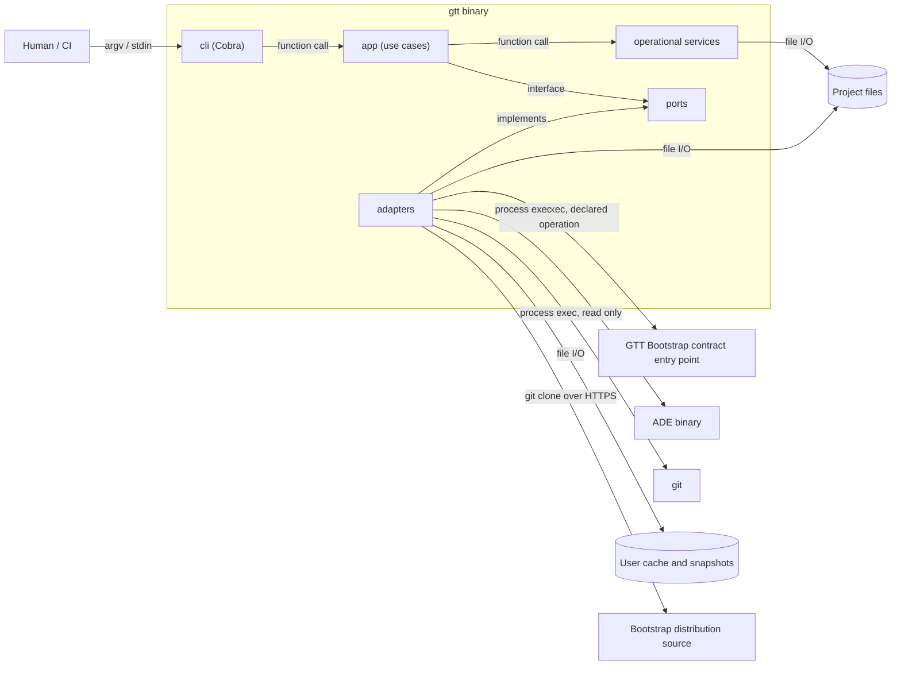
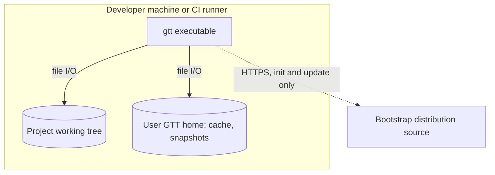

# Stack & Architecture Map

> **Canonical reference:** https://github.com/GTT-Community/gtt-method/blob/main/GTT-CANONICAL-v2.1.md

> The single view of this solution. If it is not on this page, it is not part of
> the architecture. Every approved architectural change updates this file in the
> same commit as the ADR that approves it.

- **Last verified:** `2026-10-03`
- **Governing ADRs:** ADR-001, ADR-002, ADR-003

---

## 1. Stack at a glance

| Layer | Technology | Version | Locked by |
|---|---|---|---|
| Language | Go [FUENTE: master] | 1.27 | ADR-001 |
| Runtime | Native static binary: Linux, macOS, Windows (amd64, arm64) | - | ADR-003 |
| Application framework | Cobra [FUENTE: master] | 1.x | ADR-001 |
| Compute model | Local CLI process | - | ADR-001 |
| Datastore (primary) | None - JSON files under `.gtt/cli/` | - | ADR-001 |
| Datastore (cache) | User-level Bootstrap cache on the filesystem | - | ADR-001 |
| Messaging / events | None | - | ADR-001 |
| Identity & authz | None | - | ADR-001 |
| Secrets | None stored | - | ADR-001 |
| IaC | None | - | ADR-001 |
| CI/CD | GitHub Actions | - | ADR-002 |
| Release signing | ed25519 detached signature (Go standard library) | - | ADR-002 |
| Release packaging | GoReleaser to GitHub Releases | v2 | ADR-003 |
| Observability | Leveled logs to stderr; operation log under `.gtt/cli/` | - | ADR-001 |
| Testing | Go `testing`: unit plus integration against a real Bootstrap catalog | - | ADR-001 |

---

## 2. Component map



---

## 3. Deployment topology



---

## 4. Observability

| Signal | Emitted by | Collected via | Stored in | Retention |
|---|---|---|---|---|
| Logs | CLI (error, warn, info, debug) | stderr | not stored | - |
| Metrics | none | - | - | - |
| Traces | none | - | - | - |
| Audit events | CLI operation log (timestamp, operation, result; no secrets) | append | `.gtt/cli/operations.log` | project lifetime |

**What is alerted on, and who receives it:**

| Condition | Threshold | Routed to |
|---|---|---|
| Non-zero exit code | any | the invoking human or CI job |

---

## 5. Dependency rules

| Module | May depend on | Must not depend on |
|---|---|---|
| kernel: `internal/core`, `internal/fsx`, `internal/ports` | standard library | any other internal package |
| operational services: `ade`, `project`, `methodology`, `tracking`, `agents`, `lifecycle`, `snapshot`, `export` | kernel, each other | `app`, `cli`, `compose`, adapters |
| adapters: `bootstrap`, `execution`, `ui` | kernel | `app`, `cli` |
| `internal/app` | kernel, operational services | `cli`, `compose`, adapters, Cobra |
| `internal/cli` | `app`, `output`, kernel, operational service types | adapters, `compose` |
| `internal/compose`, `cmd/gtt` | everything (composition root) | - |

---

## 6. Map change log

| Date | ADR | What changed in this map |
|---|---|---|
| 2026-10-01 | ADR-001 | Initial map from the bootstrap |
| 2026-10-03 | ADR-002 | CI/CD on GitHub Actions; release signing row; GAP-001, GAP-002, GAP-004 resolved; GAP-003 scope updated |
| 2026-10-03 | ADR-003 | Supported platforms on the Runtime row; Release packaging row (GoReleaser, GitHub Releases) |

---

## 7. Drift signals

```gtt-drift-signals
go.mod  ->  language, framework and dependency rows of section 1
cmd/**  ->  composition root rule of section 5
internal/**  ->  dependency rules of section 5
```

---

## 8. Gap register

```gtt-gaps
RESOLVED | GAP-001 | Bootstrap distribution endpoint and package signature scheme | was: OPEN | by: ADR-002
RESOLVED | GAP-002 | CI/CD provider for the CLI itself | was: OPEN | by: ADR-002
OPEN | GAP-003 | Bootstrap-side structure for initial MD tracking | scope: the CLI keeps tracking where the scaffold manifest declares it (tracking.initial_sources.path), else under .gtt/cli/, as derived state | affects: internal/tracking
RESOLVED | GAP-004 | Team plan operating policy declared by a team | was: OPEN | by: ADR-002
```

---
Governance: L0. Read-only for AI agents. Changes require an approved ADR and are
applied by the Solution Designer.
